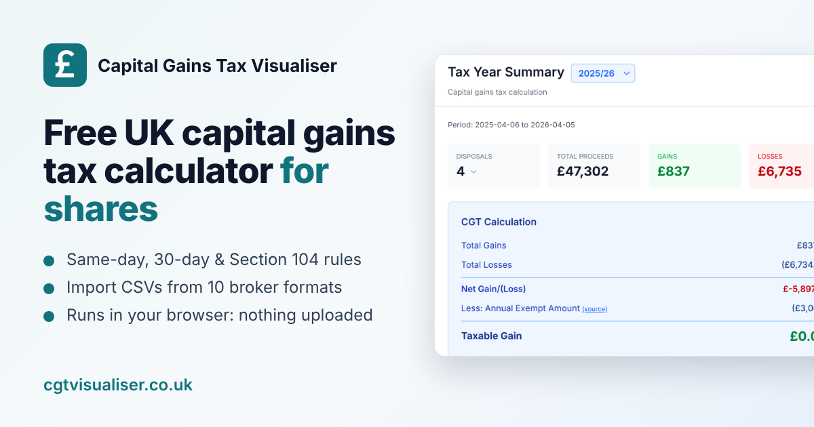

# Capital Gains Tax Visualiser: free UK CGT calculator for shares

[](https://www.npmjs.com/package/cgt-visualiser)
[](LICENSE)

**Free, open-source UK Capital Gains Tax calculator for shares.** Import your broker CSV exports, apply HMRC's same-day, 30-day ("bed and breakfast") and Section 104 rules, and get SA108-ready figures, either in your browser or from the command line. Your transactions never leave your device.

**Try it now at [cgtvisualiser.co.uk](https://cgtvisualiser.co.uk)**



## What it does

1. **Imports your transaction history** from broker CSV exports. You can mix several brokers; the same share is matched across them.
2. **Converts to GBP** using HMRC's official monthly exchange rates (or HMRC yearly averages, or ECB daily rates).
3. **Adjusts for stock splits** (TCGA92/S127). Original quantities are kept, so you can check them against your statements.
4. **Applies HMRC's matching rules** in the right order:
   - **Same-day rule** (TCGA92/S105(1), CG51560): shares bought and sold on the same day are matched first.
   - **30-day "bed and breakfast" rule** (TCGA92/S106A(5) and (5A), CG51560): shares bought back within 30 days after a sale are matched next.
   - **Section 104 pool** (TCGA92/S104, CG51620): everything else is matched against the average cost of your holding.
5. **Works out the gain or loss on every disposal**, showing which rule matched which shares, and totals each UK tax year (6 April to 5 April) against the annual exempt amount.
6. **Exports a PDF report** with the SA108 figures and the details of every disposal.

### What it covers

- Shares, ETFs and funds, in pounds or foreign currencies
- RSUs, ESPP and other employee share plans (Charles Schwab Equity Awards, EquatePlus)
- Cryptoassets (reported in the SA108 Cryptoassets section)
- Options (Interactive Brokers, Charles Schwab), each contract treated as its own asset
- Short sells and stock splits
- The 30 October 2024 rate change: 2024/25 gains are split before and after the change

### What it doesn't cover

- **ISAs and pensions (SIPPs)**: their gains are free of CGT. Leave those accounts out of what you import.
- Excess reportable income from offshore reporting funds
- Corporate actions other than stock splits, such as mergers, spin-offs and rights issues. You can enter their effect by hand in a Generic CSV.
- Property and other non-share assets

## Supported brokers

| Broker | Notes |
|---|---|
| Charles Schwab | Brokerage account and Equity Awards (RSUs, ESPP), including options |
| Interactive Brokers | Activity statement CSV, including options |
| Trading 212 | Including stock splits |
| Freetrade | |
| EquatePlus | Employee share plans: RSUs, RSPs, ESPP |
| Revolut | |
| Coinbase and Coinbase Pro | |
| Generic CSV | Any other broker: `date,type,symbol,currency,quantity,price,total,fee` |

The app explains how to export the right file from each broker.

## Guides

Plain-English guides to the rules, with worked examples checked against the calculation engine:

- [How to calculate Capital Gains Tax on shares in the UK](https://cgtvisualiser.co.uk/guides/how-to-calculate-capital-gains-tax-on-shares/)
- [The same-day rule](https://cgtvisualiser.co.uk/guides/same-day-rule/)
- [The 30-day "bed and breakfast" rule, and bed and ISA](https://cgtvisualiser.co.uk/guides/30-day-rule/)
- [The Section 104 holding (pool)](https://cgtvisualiser.co.uk/guides/section-104-pool/)
- [Stock splits](https://cgtvisualiser.co.uk/guides/stock-splits/)
- [US and other foreign shares: converting to pounds](https://cgtvisualiser.co.uk/guides/foreign-currency-shares/)
- [All guides, including how to export from each broker](https://cgtvisualiser.co.uk/guides/)

## Privacy

All processing happens in your browser, and imported data is stored only in your browser (IndexedDB). Your transactions are never uploaded. The app only fetches public reference data, and its Content Security Policy blocks connections to anywhere else:

| Service | Used for | What a request reveals |
|---|---|---|
| www.trade-tariff.service.gov.uk | HMRC exchange rates newer than the app: monthly (default) or the current year's average (optional). Rates for past months and years are built into the app and need no request | Year and month (monthly), year (yearly) |
| api.frankfurter.dev | ECB daily rates (optional) | Trade dates and currencies |
| cdn.jsdelivr.net | Stock split data (can be turned off) | Years only, not which shares you hold |

Like any web request, these reveal your IP address to the service.

## Command-line tool and AI agents

The same calculation engine is published as a command-line tool, [`cgt-visualiser`](packages/cli/README.md). It runs locally (Node.js 22 or later) and outputs text, CSV, versioned JSON or a PDF report, so it works well in scripts and for AI agents:

```bash
npx cgt-visualiser calculate my-broker-export.csv --tax-year 2024/25 --format json
```

```json
{
  "schemaVersion": 1,
  "taxYears": [
    {
      "taxYear": "2024/25",
      "disposals": 2,
      "proceedsGbp": 5440,
      "allowableCostsGbp": 4810.33,
      "netGainOrLossGbp": 629.67,
      "annualExemptAmountGbp": 3000,
      "taxableGainGbp": 0,
      ...
```

- [CLI README](packages/cli/README.md): commands, options and the full JSON schema
- [Agent guide](public/agents.md), also served at https://cgtvisualiser.co.uk/agents.md: step-by-step instructions for AI agents (Claude Code, Codex, Cursor, Gemini CLI and others)
- [`llms.txt`](public/llms.txt), served at https://cgtvisualiser.co.uk/llms.txt

## Development

Requires Node.js 22 or later.

```bash
npm install
npm run dev        # http://localhost:3000
npm test           # unit tests (Vitest)
npm run test:e2e   # end-to-end tests (Playwright)
npm run build      # production build
npm run build:cli  # build the command-line tool
```

Built with React 19, TypeScript, Vite, Tailwind CSS v4, Zustand, Dexie (IndexedDB), Zod and @react-pdf/renderer. The HMRC rules are specified in [docs/SPECIFICATION.md](docs/SPECIFICATION.md).

The CLI lives in the `packages/cli` npm workspace. To release it, set the version in `packages/cli/package.json` and push a matching `cli-v<version>` tag (e.g. `cli-v0.1.0`). The `Publish CLI to npm` workflow tests, builds and publishes it, then creates a GitHub Release. See [docs/RELEASING_CLI.md](docs/RELEASING_CLI.md), including the one-time npm setup.

## Contributing

Contributions are welcome: open an issue or pull request. To add a broker, see "Adding a New Broker Parser" in [CLAUDE.md](CLAUDE.md).

## Disclaimer

This tool is for information only. It is not financial or tax advice. Always check your figures, and consult a qualified tax professional for your situation. The developers are not responsible for any errors in calculations or tax reporting.

## License

[MIT](LICENSE)
